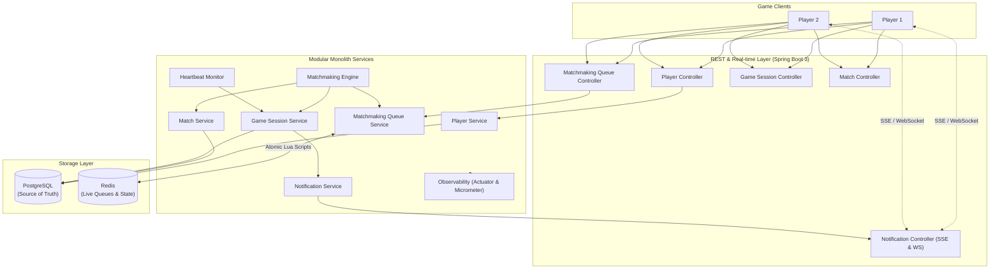
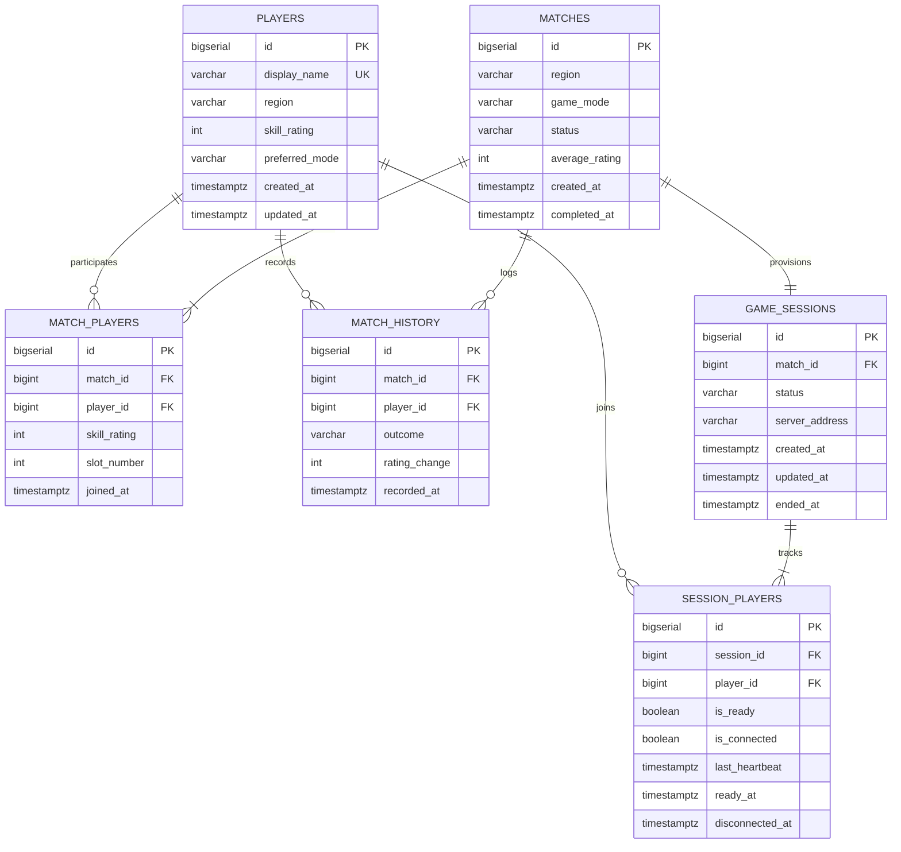

# MakeMatch: Game Matchmaking Service

A high-performance Java backend for matchmaking and game-session management built with **Spring Boot 3**, **PostgreSQL**, **Redis**, and **Docker Compose**.

Game Match Service pairs compatible players in real time based on **skill rating (Elo/MMR)**, **geographic region**, and **game mode**, manages the full lifecycle of game sessions (player check-in, ready states, heartbeats, and disconnection detection), and delivers instant notifications via **Server-Sent Events (SSE)** and **WebSocket**.

---

## Architecture Overview

Game Match Service is designed as a modular monolith where PostgreSQL serves as the persistent source of truth and Redis provides sub-millisecond in-memory queue management and concurrency control.



### Component Roles

| Technology | Responsibility | Rationale |
|---|---|---|
| **Java 17 & Spring Boot 3** | Core backend application runtime | Type safety, modern language features (records, sealed types, pattern matching), and robust enterprise framework ecosystem. |
| **PostgreSQL 17** | Persistent source of truth | Relational integrity, ACID transactions, row-level locking (`SELECT ... FOR UPDATE`), and foreign-key constraints for players, matches, sessions, and history. |
| **Redis 7** | Live queues and active state | In-memory speed, atomic multi-key Lua scripts for race-free matchmaking without distributed locks, and sorted sets for rating-based range queries. |
| **Flyway** | Database migrations | Versioned schema evolution and repeatable migrations. |
| **Spring Data JPA** | Object-relational mapping | Clean repository abstractions, pessimistic locking, and transactional boundaries. |
| **Spring Boot Actuator** | Production-ready observability | Health checks, info, and custom Micrometer metrics exposed via HTTP. |
| **Testcontainers** | Integration testing | Spin up real PostgreSQL and Redis containers for deterministic, isolated integration testing in CI/CD. |
| **Docker Compose** | Local orchestration | Single-command local environment running PostgreSQL, Redis, and the backend service. |

---

## Core Features

### 1. Player Management
- Create and query player profiles.
- Validated request payloads: display name (3-50 chars, unique), region (`NA`, `EU`, `AP`, `SA`, `OCE`), skill rating (Elo/MMR >= 0), and preferred game mode (`RANKED_1V1`, `CASUAL_1V1`, `RANKED_2V2`).

### 2. Matchmaking Engine
- **Region and Mode Partitioning**: Queues are partitioned by `(region, mode)` into dedicated Redis Sorted Sets.
- **Skill-Rating Compatibility**: Players are matched with peers within a configurable rating tolerance (default: ±150 rating points).
- **Dynamic Tolerance Expansion**: To prevent starvation in off-peak periods, the acceptable rating delta expands automatically based on elapsed queue wait time (+25 rating points every 5 seconds).
- **Atomic Concurrency Control**: All multi-step queue mutations (join, leave, pop candidate group) execute inside **atomic Redis Lua scripts**. Multiple matchmaking threads or service instances can evaluate queues simultaneously without race conditions or double-matching.
- **Idempotency & Duplicate Prevention**: Players are registered in an active player set; duplicate join attempts are safely recognized and return current queue status without corrupting queue state.
- **Queue Leaving**: Players can leave the queue cleanly at any point prior to match creation.

### 3. Match Creation & State Transitions
- When sufficient compatible players are available, the matchmaking engine atomically pops candidates from Redis.
- Persists the match in PostgreSQL with initial status `WAITING` or `READY`.
- Automatically provisions a corresponding `GameSession` and assigns a dedicated game server endpoint.
- Lifecycle statuses: `WAITING` → `READY` → `ACTIVE` → `COMPLETED` / `CANCELLED`.

### 4. Game-Session Management
- **Ready-Up Mechanism**: Players submit ready confirmations (`POST /api/v1/sessions/{id}/ready`). When all players are ready, the session and match transition to `ACTIVE`.
- **Heartbeat Tracking**: Connected clients send periodic heartbeats (`POST /api/v1/sessions/{id}/heartbeat`).
- **Disconnection Detection**: A scheduled background monitor scans active sessions. If a player fails to send a heartbeat within the timeout threshold (default: 15s), they are marked disconnected and remaining participants are alerted.
- **Session Resolution & History**: Sessions can be completed with a winner or cancelled. Winner and loser skill ratings are updated (+25 / -25) and match outcomes are recorded in PostgreSQL match history.

### 5. Real-Time Updates (SSE & WebSocket)
- **Server-Sent Events (SSE)**: Streaming endpoint at `GET /api/v1/notifications/stream/{playerId}`.
- **WebSocket**: Full duplex connection at `/ws/notifications?playerId={playerId}`.
- **Events Dispatched**:
  - `CONNECTED` (handshake)
  - `MATCH_FOUND` (with assigned server and match ID)
  - `PLAYER_READY` (when an opponent readies up)
  - `SESSION_STATE_CHANGED` (transition to `ACTIVE`)
  - `PLAYER_DISCONNECTED` (when a participant's heartbeat lapses)
  - `SESSION_COMPLETED` (winner announcement and rating deltas)
  - `SESSION_CANCELLED`
- **Graceful Reconnects**: Recent messages are cached in a per-player circular replay buffer and re-emitted upon reconnect.

### 6. Observability & Metrics
Exposed via Spring Boot Actuator at `/actuator/metrics` and `/actuator/health`:
- `gamematch.queue.size` — Gauge tracking total active players in queue.
- `gamematch.matchmaking.attempts` — Counter tracking matchmaking evaluation cycles.
- `gamematch.matches.success` — Counter tracking successfully formed matches.
- `gamematch.matches.failed` — Counter tracking failed match creation transactions.
- `gamematch.matchmaking.time` — Timer measuring matchmaking evaluation duration.
- `gamematch.sessions.active` — Gauge tracking currently active sessions.
- `gamematch.players.disconnected` — Counter tracking disconnected players.
- `gamematch.api.errors` — Counter tracking API errors handled by the global exception handler.

---

## Redis Data Structures

```
Redis Keys:
├── gamematch:queue:active_players               (Set: player IDs currently in queue)
├── gamematch:queue:player_info                  (Hash: playerId -> JSON queue entry)
└── gamematch:queue:{region}:{mode}              (Sorted Set: score = skillRating, member = playerId)
```

1. **`gamematch:queue:active_players`** (Redis Set):
   $O(1)$ membership test (`SISMEMBER`) to verify if a player is queued and prevent duplicate entries.
2. **`gamematch:queue:player_info`** (Redis Hash):
   Stores serialized `QueueEntry` metadata (region, mode, skill rating, joined timestamp) for instant lookup upon leaving or requeuing.
3. **`gamematch:queue:{region}:{mode}`** (Redis Sorted Set):
   Indexed by skill rating. Enables efficient range queries (`ZRANGEBYSCORE`) to identify players within rating tolerance in $O(\log N + M)$ time.

---

## Database Schema (PostgreSQL)



---

## API Summary

| Method | Endpoint | Description |
|---|---|---|
| `POST` | `/api/v1/players` | Register a new player profile |
| `GET` | `/api/v1/players/{id}` | Retrieve player profile and skill rating |
| `POST` | `/api/v1/queue/join` | Join matchmaking queue (idempotent) |
| `POST` | `/api/v1/queue/leave` | Leave matchmaking queue |
| `GET` | `/api/v1/queue/status/{playerId}` | Check player's queue status and wait time |
| `GET` | `/api/v1/queue/size` | Query total and per-mode queue sizes |
| `GET` | `/api/v1/matches/{id}` | Retrieve match details and roster |
| `GET` | `/api/v1/sessions/{id}` | Retrieve session details, player ready states, and connectivity |
| `POST` | `/api/v1/sessions/{id}/ready` | Mark player as ready for the match |
| `POST` | `/api/v1/sessions/{id}/heartbeat` | Send client heartbeat |
| `POST` | `/api/v1/sessions/{id}/complete` | Finish session, declare winner, update ratings |
| `POST` | `/api/v1/sessions/{id}/cancel` | Cancel an ongoing session |
| `GET` | `/api/v1/sessions/history/{playerId}` | Retrieve player's completed match history |
| `GET` | `/api/v1/notifications/stream/{playerId}` | SSE real-time notification stream |
| `WS` | `/ws/notifications?playerId={playerId}` | WebSocket real-time notification stream |
| `GET` | `/actuator/health` | Application health status |
| `GET` | `/actuator/metrics/{metricName}` | Actuator observability metric inspection |

---

## Local Setup & Deployment

### Prerequisites
- **Java 17** (or compatible JDK)
- **Maven 3.9+** (or use included `./mvnw`)
- **Docker** and **Docker Compose**

### 1. Configure Environment
Copy the sample environment file:
```bash
cp .env.example .env
```

### 2. Start with Docker Compose
To run the full stack (PostgreSQL, Redis, and Spring Boot application):
```bash
docker compose up --build -d
```

Verify services are healthy:
```bash
docker compose ps
curl http://localhost:8080/actuator/health
```

### 3. Run Locally from IDE or Terminal
To run only the database and cache in Docker while developing the app locally:
```bash
docker compose up postgres redis -d
./mvnw spring-boot:run
```

### 4. Interactive Testing
- **Swagger / OpenAPI UI**: [http://localhost:8080/swagger-ui.html](http://localhost:8080/swagger-ui.html)
- **REST Client (`requests.http`)**: Execute requests sequentially using VS Code REST Client or IntelliJ HTTP client.
- **End-to-End Demo Script**:
```bash
./scripts/demo.sh
```

---

## Running Tests

Run the complete test suite (unit tests with JUnit 5 & Mockito, and integration tests with Testcontainers):
```bash
./mvnw clean verify
```

To run only unit tests:
```bash
./mvnw test
```

To run only integration tests:
```bash
./mvnw verify -DskipUnitTests=true
```

